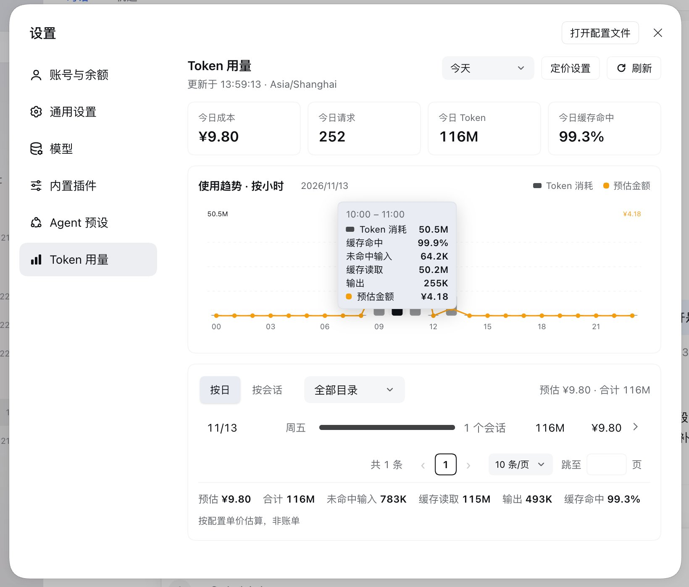

# Token 用量统计

> DeepSeek Harness 的本地 token 用量与预估费用统计插件。  
> Local token usage and estimated cost statistics for DeepSeek Harness.

<p align="center">
  
</p>

打开 **设置 → Token 用量**，就能看到今天和所选日期范围内的 token 消耗、请求数、缓存命中率，以及按模型单价估算的人民币金额。数据全部来自本机会话日志，不上传、不修改任何会话。

<p align="center">
  
  <br />
  <sub>设置 → Token 用量：今日卡片、按小时趋势与悬浮明细</sub>
</p>

## 功能

- **今日 / 区间统计卡片**：成本、请求数、Token、缓存命中率。
- **使用趋势**：根据筛选范围自动切换
  - 单日 → 按小时柱状图（最近 31 天有小时级数据）；
  - 2 ~ 15 天 → 按日柱状图 + 金额折线；
  - 超过 15 天或「全部日期」→ 用量热力图（左侧周几固定，右侧可横向滚动，空白天数用浅色填充）。
- **按日 / 按会话两个列表**：目录筛选、日期筛选；父会话聚合子代理；分页支持总条数、页码、每页 10/20/50/100 条和跳页。
- **悬浮明细**：柱状图和热力图 hover 显示日期/小时、Token 总量、缓存命中率、未缓存输入、缓存读取、输出、预估金额。
- **预估费用**：CNY；DeepSeek 按官方高峰/闲时价，其他模型按统一价；页内「定价设置」可直接改价、加模型、维护节假日。
- **纯本地只读**：读取 `~/.dsh/sessions` 下的会话日志，不访问外网，不写入会话日志。
- **零依赖、零构建**：Host 是普通 ESM，Client 是单文件模块，没有 npm 依赖和打包步骤。

## 安装

要求：DSH 带有 `sessionQuery` 与 `webServer` 服务（Desktop / Web 均满足）。

1. 克隆仓库：
   ```bash
   git clone <repo-url>
   ```
2. 打开 DSH，进入 **设置 → 内置插件 → 添加插件**，选择本目录（包含 `package.json` 的那一层）。
3. 安装后刷新页面。如果 Host 侧代码有更新，重启一次应用；之后只有 Client 改动时会自动热更新。

> 插件以「本地目录 bundle」形式安装，由 Plugin Manager 链接到当前 profile，不会发布到 npm。

## 使用

打开 **设置 → Token 用量**：

- **日期范围**（标题右侧，默认今天）：今天 / 近 7 天 / 近 14 天 / 近 30 天 / 全部日期，或点开日历自选起止日期。
- **目录筛选**（列表上方）：只看某个工作目录，或全部目录。
- **图表**：单日按小时、2~15 天按日、更长范围或「全部日期」自动切热力图。
- **列表**：按日、按会话；点行展开明细；父会话行显示「自身 + 子代理」合计。
- **分页**：列表底部，整体靠右；支持页码、每页条数、跳至第 N 页。
- **定价设置**（右上角）：编辑每个模型的单价，保存后金额立即按新单价重算。

## 数字口径

总数与任务窗口下方 composer 的用量 pill 一致：

```
totalTokens = 未缓存输入 + 缓存读取 + 缓存写入 + 输出
```

- 数据来自本地会话日志里的 `assistant/message` / `assistant/attempt` usage。
- 同一 `(turn, step)` 的重试按 DSH 投影语义折叠：后一次替换前一次；`llm/retry-started` 后的下一次尝试算新增。
- 子代理是独立会话，不会重复计入父会话；父会话行显示「自身 + 子代理」合计。
- fork / 分叉会话只统计 `inheritedEventCount` 之后的自有事件，避免前缀重复。
- 日期按事件发生时间（浏览器时区）归日；归档会话计入，零用量会话不计入。

## 预估费用

- 币种 CNY，单位：元 / 百万 tokens。
- DeepSeek：北京时间周一至周五 9:00–12:00、14:00–18:00 为高峰，其余为闲时；周末和配置的节假日按闲时。
- 其他模型：统一价（缓存命中 / 未命中 / 输出各一个价）。
- 内置 DeepSeek 官方在售模型的默认价格；其他模型在「定价设置」里添加。
- 单价保存在插件目录 `prices.json`（首次保存时生成，已加入 `.gitignore`）。
- **金额是按列表价的估算，不是账单**：账户优惠、赠送额度、汇率、四舍五入都会造成差异，账户余额才是准数。

## 隐私

- 只读本机会话日志（`~/.dsh/sessions`），不访问外网、不上传任何数据。
- 不新增、不修改会话事件；卸载插件不会影响历史会话。
- 数据接口由 DSH 本机 web server 提供（桌面版通过应用协议转发），不额外开监听端口。

## 已知限制

- 小时级数据只发布最近 31 天；更早的单日会退回按日柱状图。
- 「全部日期」热力图默认只推今天往前约 30 周；数据更早时才扩展并可横向滚动。
- 价格表和节假日需要手动维护；价格变动后请在「定价设置」里更新。
- 依赖 DSH 的 `sessionQuery` / `webServer` 服务，不适用于没有这两个服务的裁剪版本。

## 目录结构

```
token-stats/
├── index.js            # Host：读取会话日志、聚合、费用估算、数据路由
├── client.js           # Client：设置页签、卡片、图表、列表、定价设置
├── cordis.patch.yml    # Plugin Manager 插入的 Host 行
├── package.json        # bundle 清单与 dsh.bundle / dsh.client 配置
├── locale/             # Plugin Manager 的插件标题与简介（zh / en）
├── docs/DETAIL.md      # Plugin Manager 详情页
├── icon.svg            # 插件图标
└── prices.json         # 首次保存定价时生成（已 gitignore）
```

### 开发

- Host 路由：`GET /dsh-token-stats`（统计数据）、`POST /dsh-token-stats/prices`（保存价目表）。
- Client 通过相对路径访问，Desktop 的 `dsh-app://app` 协议会转发到 Host。
- 无构建步骤：`client.js` 直接以 `window.__ModuleLoader__.load({ id, factory })` 形式注册。
- Host 改动需要重启应用；Client 改动会热更新。安装后的目录由 profile 链接，修改工作区文件即可。

## 兼容性

开发与验证环境：DSH `0.2.2-rc.2`（Desktop，macOS）。Web 版使用同样的 `webServer` 路由，预期可用但未单独验证。

> 当前包名是 `@local/dsh-token-stats`。如果以后要发布到 npm，需要同时修改 `package.json`、`cordis.patch.yml`、`client.js` 中的模块 id，并重新安装。

## 许可证

MIT License，详见 [LICENSE](LICENSE)。

Copyright (c) 2026 与归
